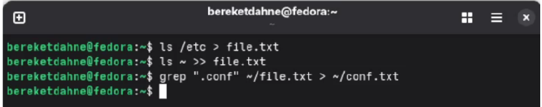

# Лабораторная работа № 8
## Поиск файлов. Перенаправление ввода-вывода. Просмотр запущенных процессов

---

### Цель работы
Ознакомление с инструментами поиска файлов и фильтрации текстовых данных. Приобретение практических навыков по управлению процессами, по проверке использования диска и обслуживанию файловых систем.

---

### Выполнение работы

#### 1. Запись файлов из /etc в file.txt
```bash
ls /etc > ~/file.txt
```

#### 2. Добавление файлов из домашнего каталога
```bash
ls ~ >> ~/file.txt
```

#### 3. Поиск файлов с расширением .conf
```bash
grep ".conf" ~/file.txt > ~/conf.txt
```

#### 4. Поиск файлов, начинающихся с символа c
```bash
find ~ -name "c*" -print
```

#### 5. Вывод файлов из /etc, начинающихся с h
```bash
ls /etc | grep "^h" | less
```

#### 6. Запуск процесса в фоновом режиме
```bash
find ~ -name "log*" -print > ~/logfile &
```

#### 7. Удаление logfile
```bash
rm ~/logfile
```

#### 8. Запуск gedit в фоновом режиме
```bash
gedit &
```

#### 9. Определение PID процесса gedit
```bash
ps aux | grep gedit
```

#### 10. Чтение справки по kill и завершение процесса
```bash
man kill
kill <PID>
```

#### 11. Проверка использования диска
```bash
df -h
du -a ~
```

#### 12. Поиск всех директорий в домашнем каталоге
```bash
find ~ -type d
```

---

### Результаты работы

**Скриншот 1:** Запись файлов и поиск .conf
\newline
{ widht=4in }

**Скриншот 2:** Поиск файлов и упраение процессами
\newline
{ widht=4in }

**Скриншот 3:** Проверка диска
\newline
{ widht=4in }

---

### Ответы на контрольные вопросы

**1. Какие потоки ввода-вывода вы знаете?**
stdin (стандартный ввод, дескриптор 0), stdout (стандартный вывод, дескриптор 1), stderr (стандартный вывод ошибок, дескриптор 2).

**2. Объясните разницу между операцией > и >>.**
`>` перезаписывает файл, `>>` добавляет в конец файла.

**3. Что такое конвейер?**
Конвейер (`|`) передаёт вывод одной команды на вход другой команде.

**4. Что такое процесс? Чем это понятие отличается от программы?**
Процесс — это выполняющаяся программа. Программа — это файл с инструкциями, процесс — это активное выполнение этих инструкций.

**5. Что такое PID и GID?**
PID (Process ID) — идентификатор процесса. GID (Group ID) — идентификатор группы.

**6. Что такое задачи и какая команда позволяет ими управлять?**
Задачи (jobs) — это процессы, запущенные в фоновом режиме. Управляются командой `jobs`.

**7. Найдите информацию об утилитах top и htop. Каковы их функции?**
`top` и `htop` — утилиты для мониторинга процессов в реальном времени. Показывают загрузку CPU, памяти, список процессов.

**8. Назовите и дайте характеристику команде поиска файлов. Приведите примеры использования этой команды.**
Команда `find` ищет файлы по заданным критериям. Пример: `find ~ -name "*.txt" -print`.

**9. Можно ли по контексту (содержанию) найти файл? Если да, то как?**
Да, с помощью команды `grep`. Пример: `grep "текст" file.txt`.

**10. Как определить объем свободной памяти на жёстком диске?**
Команда `df -h`.

**11. Как определить объем вашего домашнего каталога?**
Команда `du -sh ~`.

**12. Как удалить зависший процесс?**
Найти PID командой `ps aux | grep имя`, затем `kill <PID>` или `kill -9 <PID>` для принудительного завершения.

---

### Выводы

В ходе выполнения лабораторной работы № 8 я ознакомился с инструментами поиска файлов и фильтрации текстовых данных. Я приобрёл практические навыки по управлению процессами, проверке использования диска и обслуживанию файловых систем.

Таким образом, цель работы была полностью достигнута.
```

